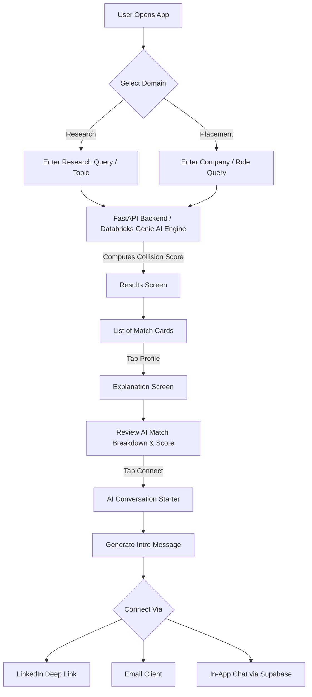

# Campus Connect 🎓🤝

> **Empowering Intelligent Campus Discovery & Peer Collisions**  
> *Formerly known as The Collision Engine*

Campus Connect is a native Android mobile application designed to facilitate meaningful peer and faculty discovery on university campuses. Moving away from traditional keyword search or basic messaging UI, Campus Connect leverages **Databricks Genie AI Engine** & **NVIDIA NIM APIs** to compute **"Collision Scores"** across academic research, placement preparation, methodologies, and technical hardware domains.

---

## 🌟 Key Features

- **🔬 Research Collisions:**  
  Find peers, researchers, and faculty working on overlapping research topics, hardware components (e.g., Raspberry Pi, Jetson Nano, FPGA), AI domains, and methodologies.

- **💼 Placement Collisions:**  
  Discover seniors and peers who have interviewed at target tech companies for specific roles (e.g., Software Engineer, Data Scientist, ML Engineer), providing role insights and interview prep guidance.

- **🤖 Databricks Genie & NVIDIA AI Integration:**  
  Leverages natural language querying via Databricks Genie space search and NVIDIA AI models to process complex domain queries and generate context-rich match explanations.

- **💡 Explainable AI Match Scores:**  
  Provides transparent match percentages and broken-down explanations detailing *why* two candidates match (shared methodologies, overlapping technical domains, target company overlap).

- **💬 AI Icebreaker & Conversation Starter:**  
  Automatically generates personalized, contextual introductory messages to help students initiate outreach via LinkedIn, Email, or In-App Chat.

- **🧪 Interactive Collision Simulator:**  
  Allows students and researchers to simulate custom matching metrics and visualize how collision scores are computed across dynamic query parameters.

- **👍 Feedback Loop & Rating System:**  
  Built-in match rating system (thumbs up/down) to continuously evaluate and optimize matching recommendations.

---

## 📐 Architecture Flowchart



---

## 🏗️ Project Architecture

```
CampusConnect--Databricks/
├── app/                        # Android Client (Kotlin / Jetpack Compose)
│   └── src/main/java/com/example/collisionengine/
│       ├── data/               # Models, Local Datasets & Network Clients (Databricks, NVIDIA)
│       └── ui/                 # Jetpack Compose Screens (Home, Research, Placement, Results, etc.)
├── backend campus/             # Python FastAPI Backend
│   ├── main.py                 # REST API Endpoints & Matching Service
│   ├── services/genie.py       # Databricks Genie AI Integration
│   └── test_genie.py           # Unit tests & verification
├── dataset/                    # Academic & Placement JSON Datasets
│   ├── Faculty.json            # Faculty research profiles & papers
│   ├── Placement.json          # Placement interview experiences & target roles
│   ├── Projects.json           # Student projects & hardware stack
│   ├── Research.json           # Research topics & domain mappings
│   └── Students.json           # Student profiles, skills & interests
└── README.md
```

---

## 🛠️ Tech Stack & Requirements

### **Mobile App (Android)**
- **Language:** Kotlin
- **UI Framework:** Jetpack Compose (Material Design 3)
- **Architecture:** MVVM (Model-View-ViewModel) + StateFlow
- **Minimum SDK:** API 24 (Android 7.0)
- **Target / Compile SDK:** API 35
- **Build System:** Gradle (Kotlin DSL, Java 17)

### **Backend & AI Engine**
- **Language:** Python 3.11+
- **Framework:** FastAPI / Uvicorn
- **AI Integration:** Databricks Genie Space API & NVIDIA NIM API
- **Dataset Storage:** Structured JSON Datasets / Databricks Delta Tables

---

## 🚀 How to Setup & Run

### 1. **Clone the Repository**
```bash
git clone https://github.com/adithya6845/campusconnect.git
cd campusconnect
```

### 2. **Run Backend (FastAPI)**
```bash
cd "backend campus"
pip install -r requirements.txt
python main.py
```

### 3. **Run Android App**
1. Open **Android Studio** (Jellyfish or newer recommended).
2. Select **File -> Open** and choose the `CampusConnect` directory.
3. Verify JDK version under **Settings -> Build, Execution, Deployment -> Build Tools -> Gradle** is set to **Java 17**.
4. Sync Gradle and click **Run 'app'** (`Shift + F10`) on an emulator or connected Android device.

---

## 🗺️ Future Roadmap
- [ ] **Live Databricks Delta Sharing:** Transition from offline datasets to live Databricks REST API endpoints.
- [ ] **Real-time WebSockets:** Implement Supabase WebSockets for instant in-app messaging.
- [ ] **Graph Analytics:** Visual collision network graph showing campus interest clusters.

---

## 📜 License
Distributed under the MIT License.
